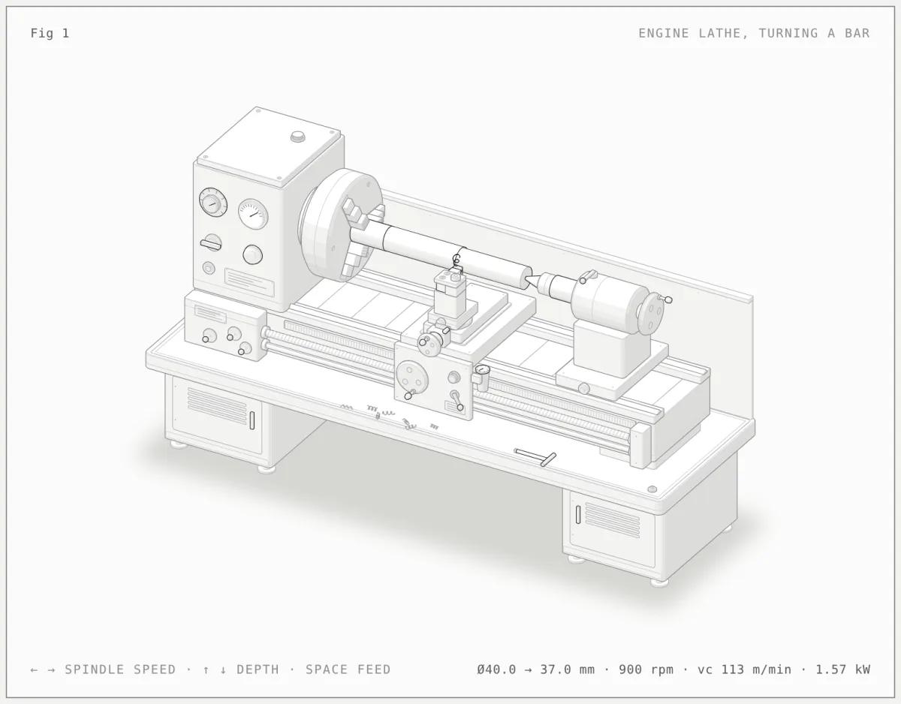
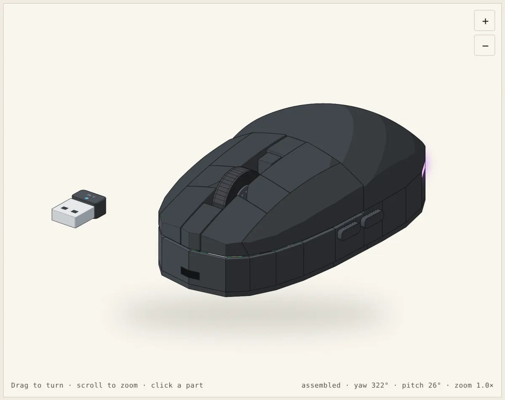
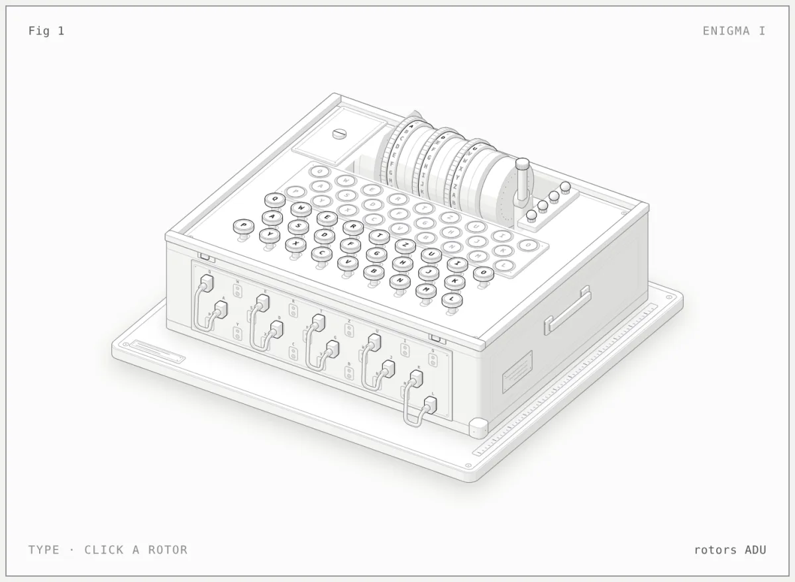
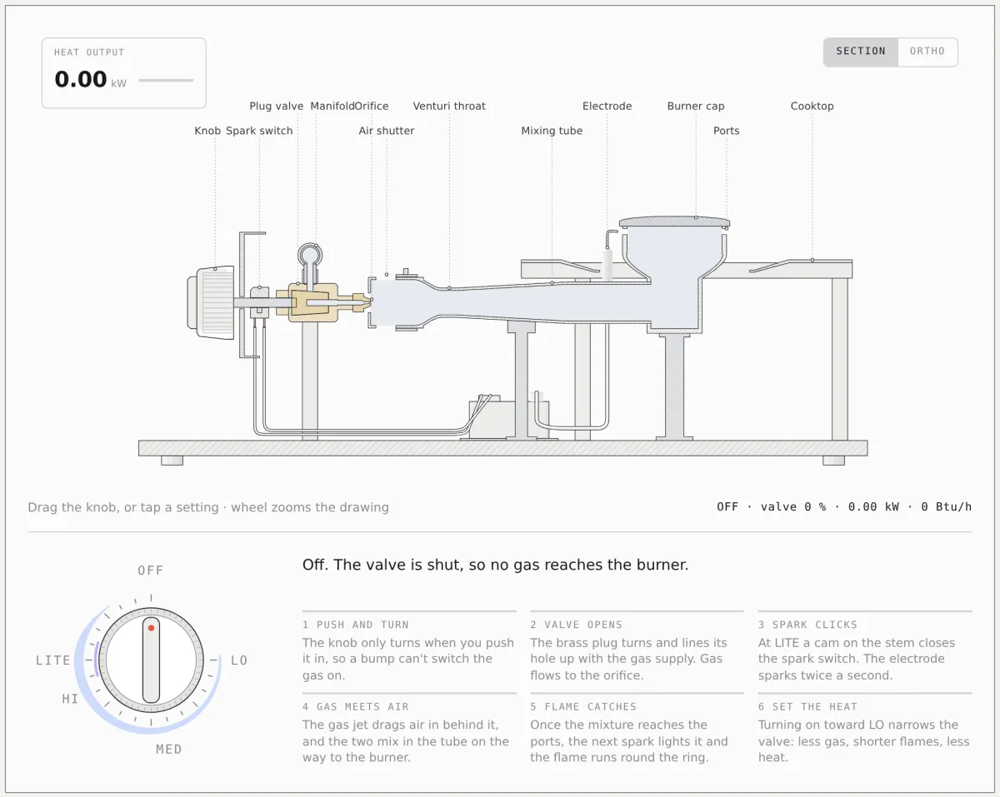
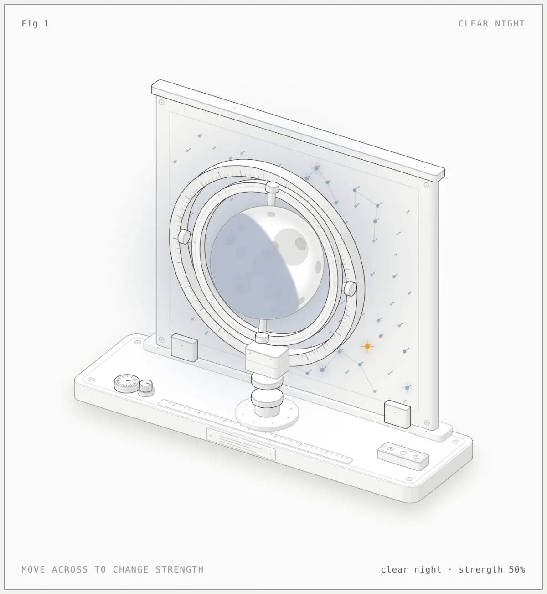
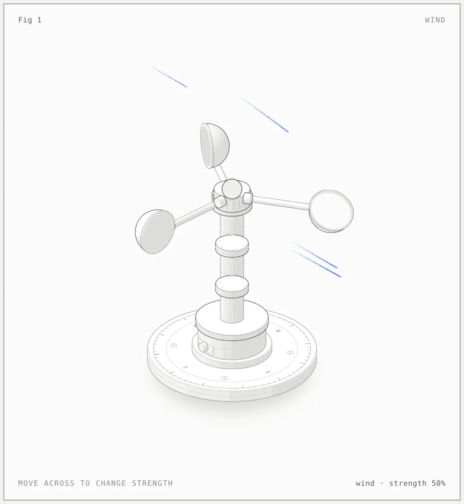
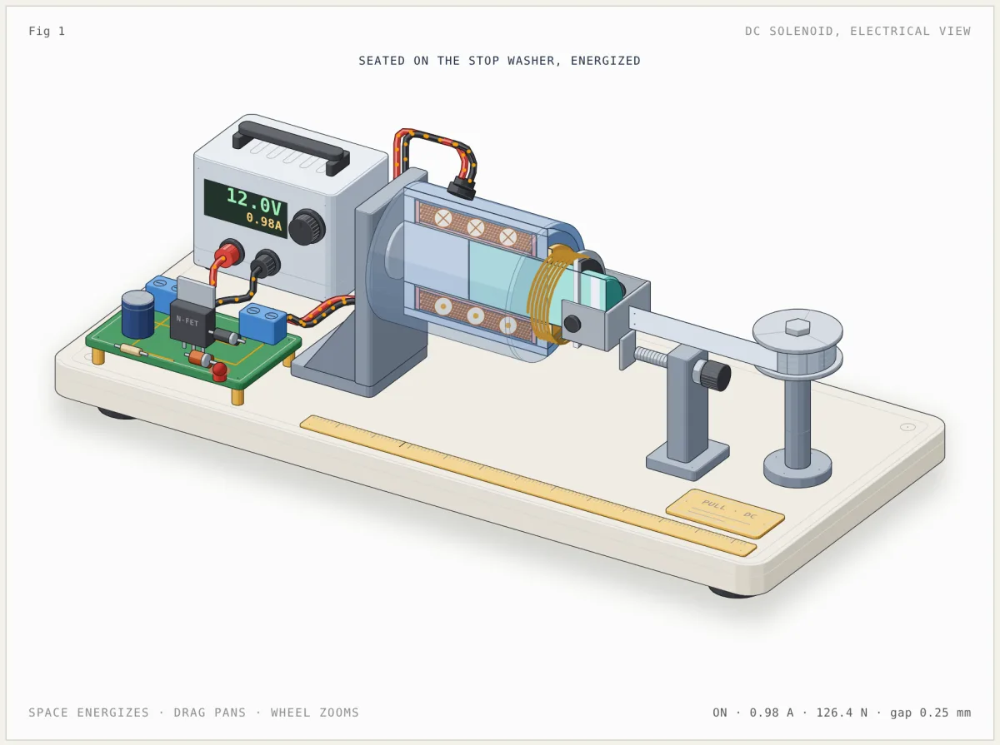
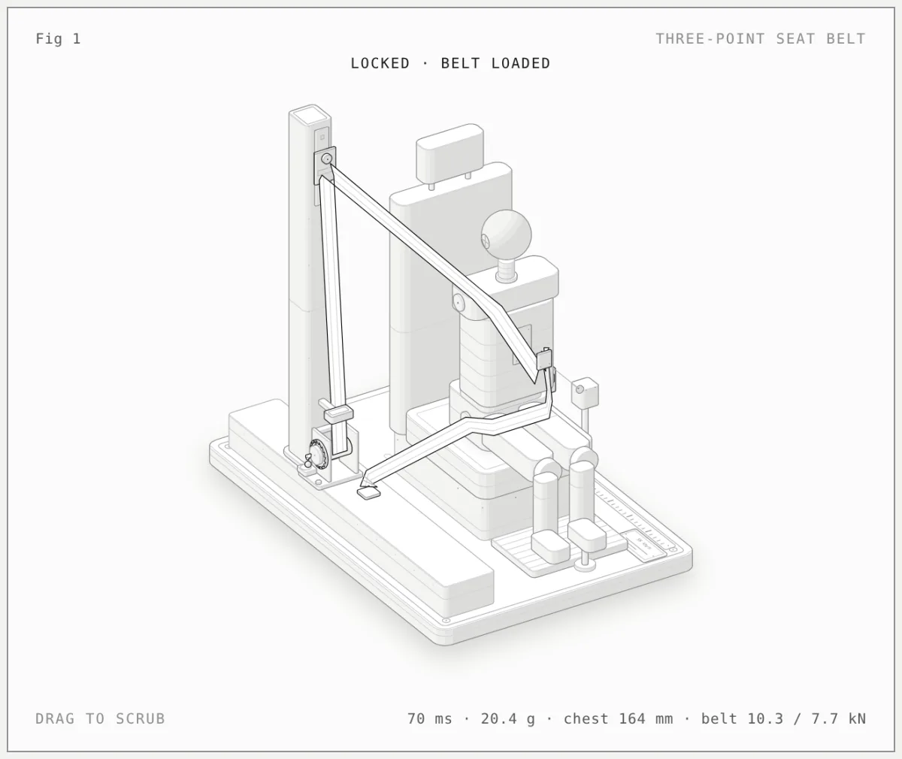
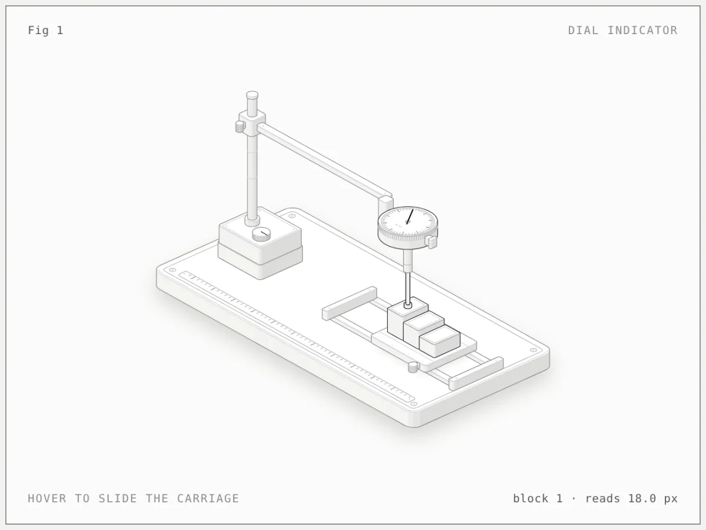
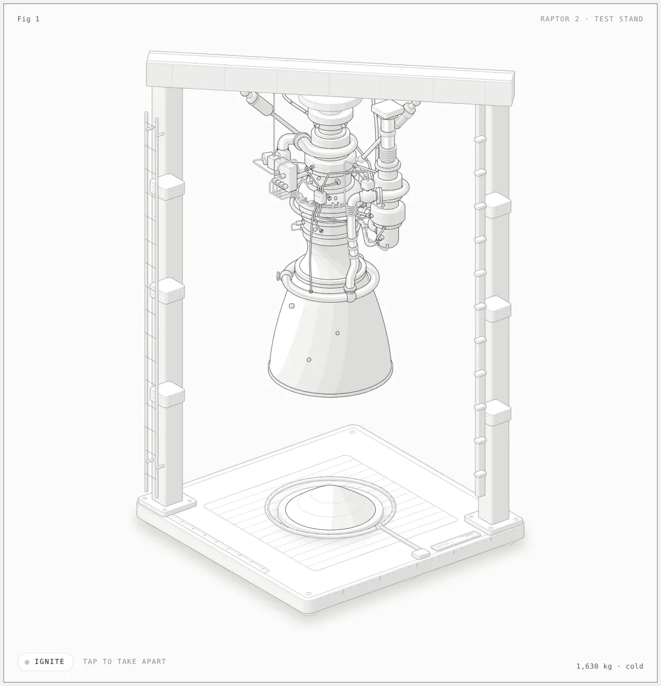

# All figures, page 1 of 1

[Newest](../README.md) · [All figures](../all/1.md) · By kind: [SVG](../by-kind/svg.md) · [SVG + WebGL](../by-kind/webgl.md) · [SVG + 3D](../by-kind/3d.md)

Page 1 of 1

| Preview | Figure |
|---|---|
|  | **Engine lathe, turning a bar** by [@camidev43](../by-author/camidev43.md) SVG · Claude Code · 2026-10-20 |
|  | **TM-T20: impressora térmica** by [@feliperequiasoares](../by-author/feliperequiasoares.md) SVG · Claude Code · 2026-10-16 |
|  | **Inside a wireless gaming mouse** by [@vinayanand3](../by-author/vinayanand3.md) SVG &#43; 3D · Claude Code · 2026-10-16 |
|  | **From computer to ALU** by [@zintaen](../by-author/zintaen.md) SVG · Antigravity · 2026-10-16 |
|  | **Deadweight pressure tester** by [@zintaen](../by-author/zintaen.md) SVG · Antigravity · 2026-10-16 |
|  | **Geneva indexing drive** by [@zintaen](../by-author/zintaen.md) SVG &#43; 3D · Antigravity · 2026-10-16 |
|  | **Enigma I cipher machine** by [@lior-pesoa](../by-author/lior-pesoa.md) SVG · Claude Code · 2026-10-15 |
|  | **Inside a Kitchen Gas Burner** by [@vinayanand3](../by-author/vinayanand3.md) SVG &#43; WebGL · Other · 2026-10-15 |
|  | **AUX Water Dispenser: Storage, Heating &#38; Flow** by [@28H2O2](../by-author/28h2o2.md) SVG · Codex · 2026-10-14 |
|  | **Medieval Watermill — Dimensioned Assembly Manual** by [@ArtomStatsenko](../by-author/artomstatsenko.md) SVG · Codex · 2026-10-14 |
|  | **Cold therapy unit** by [@jack-margeson](../by-author/jack-margeson.md) SVG · Claude Code · 2026-10-14 |
|  | **Weather: Clear night, lunar globe in a gimbal in front of a pin-field star board** by [@masterthepixel](../by-author/masterthepixel.md) SVG · Claude Code · 2026-10-14 |
|  | **Weather: Wind, cup anemometer on a compass base** by [@masterthepixel](../by-author/masterthepixel.md) SVG · Claude Code · 2026-10-14 |
|  | **Tamagotchi teardown** by [@pixelyokai](../by-author/pixelyokai.md) SVG · Claude Code · 2026-10-14 |
|  | **Sony Discman ESP D-421SP** by [@The-Mambo](../by-author/the-mambo.md) SVG · Other · 2026-10-14 |
|  | **An agent step: tools, a schema gate, a keyed seal, a trace** by [@ahmadssadiq](../by-author/ahmadssadiq.md) SVG · Claude Code · 2026-10-13 |
|  | **Typewriter** by [@DanielJ06](../by-author/danielj06.md) SVG · Claude Code · 2026-10-13 |
|  | **M 290 Metal 3D Printer, Simulated** by [@EntangledQuantum](../by-author/entangledquantum.md) SVG · Claude Code · 2026-10-13 |
|  | **Brazilian electric shower** by [@fmenegui](../by-author/fmenegui.md) SVG · Codex · 2026-10-13 |
|  | **Debounce bench** by [@Nuzairb](../by-author/nuzairb.md) SVG · Claude Code · 2026-10-13 |
|  | **The quotum machine** by [@quotumorg](../by-author/quotumorg.md) SVG &#43; WebGL · Claude Code · 2026-10-13 |
|  | **Basket Air Fryer** by [@The-Mambo](../by-author/the-mambo.md) SVG · Other · 2026-10-13 |
|  | **DC solenoid, electrical view** by [@vinayanand3](../by-author/vinayanand3.md) SVG · Other · 2026-10-13 |
|  | **Three-Point Seat Belt** by [@vinayanand3](../by-author/vinayanand3.md) SVG · Claude Code · 2026-10-13 |
|  | **Ford PowerShift DPS6 twin dry clutch** by [@yishan](../by-author/yishan.md) SVG · Claude Code · 2026-10-13 |
|  | **GitLab Runner job bench** by [@zzgosh](../by-author/zzgosh.md) SVG · Claude Code · 2026-10-13 |
|  | **Cu/diamond composite: post-mixing vs pre-coating** by [@entity](../by-author/entity.md) SVG · Claude Code · 2026-10-12 |
|  | **Film projector** by [@entity](../by-author/entity.md) SVG · Claude Code · 2026-10-12 |
|  | **Game Boy** by [@entity](../by-author/entity.md) SVG · Claude Code · 2026-10-12 |
|  | **Gumball machine** by [@entity](../by-author/entity.md) SVG · Claude Code · 2026-10-12 |
|  | **Jukebox** by [@entity](../by-author/entity.md) SVG · Claude Code · 2026-10-12 |
|  | **Lever espresso machine** by [@entity](../by-author/entity.md) SVG · Claude Code · 2026-10-12 |
|  | **NES controller** by [@entity](../by-author/entity.md) SVG · Claude Code · 2026-10-12 |
|  | **Polaroid camera** by [@entity](../by-author/entity.md) SVG · Claude Code · 2026-10-12 |
|  | **Pop-up toaster** by [@entity](../by-author/entity.md) SVG · Claude Code · 2026-10-12 |
|  | **Walkman cassette player** by [@entity](../by-author/entity.md) SVG · Claude Code · 2026-10-12 |
|  | **Floating-caliper disc brake** by [@gudguliai](../by-author/gudguliai.md) SVG &#43; 3D · Other · 2026-10-12 |
|  | **How Machu Picchu was built** by [@jcroccomendez](../by-author/jcroccomendez.md) SVG · Claude Code · 2026-10-12 |
|  | **Powerbank anatomy: how a 25,000 mAh 200 W powerbank works** by [@minhaajre](../by-author/minhaajre.md) SVG · OpenCode · 2026-10-12 |
|  | **Click pen** by [@nader0913](../by-author/nader0913.md) SVG · Other · 2026-10-12 |
|  | **Flush toilet** by [@nader0913](../by-author/nader0913.md) SVG · Other · 2026-10-12 |
|  | **Four-stroke engine** by [@nader0913](../by-author/nader0913.md) SVG · Other · 2026-10-12 |
|  | **Geneva drive film advance** by [@nader0913](../by-author/nader0913.md) SVG · Other · 2026-10-12 |
|  | **Swiss lever escapement** by [@nader0913](../by-author/nader0913.md) SVG · Other · 2026-10-12 |
|  | **Open differential** by [@nader0913](../by-author/nader0913.md) SVG · Other · 2026-10-12 |
|  | **Combination padlock** by [@nader0913](../by-author/nader0913.md) SVG · Other · 2026-10-12 |
|  | **Pin tumbler lock** by [@nader0913](../by-author/nader0913.md) SVG · Other · 2026-10-12 |
|  | **Wankel rotary engine** by [@nader0913](../by-author/nader0913.md) SVG · Other · 2026-10-12 |
|  | **Zipper** by [@nader0913](../by-author/nader0913.md) SVG · Other · 2026-10-12 |
|  | **Automatic watch** by [@srirangam-r](../by-author/srirangam-r.md) SVG · Claude Code · 2026-10-12 |
|  | **Keyboard switch, sawn open** by [@taqh](../by-author/taqh.md) SVG · Claude Code · 2026-10-12 |
|  | **BMW iX3 on the bench** by [@tiago-varandas](../by-author/tiago-varandas.md) SVG · Claude Code · 2026-10-12 |
|  | **Steering Column Impact Test** by [@vinayanand3](../by-author/vinayanand3.md) SVG · Claude Code · 2026-10-12 |
|  | **Dial indicator** by [@wheresryan22](../by-author/wheresryan22.md) SVG · Claude Code · 2026-10-12 |
|  | **Raptor engine on the test stand** by [@wheresryan22](../by-author/wheresryan22.md) SVG &#43; WebGL · Claude Code · 2026-10-12 |
|  | **Ripple tank** by [@wheresryan22](../by-author/wheresryan22.md) SVG &#43; WebGL · Claude Code · 2026-10-12 |

Page 1 of 1
