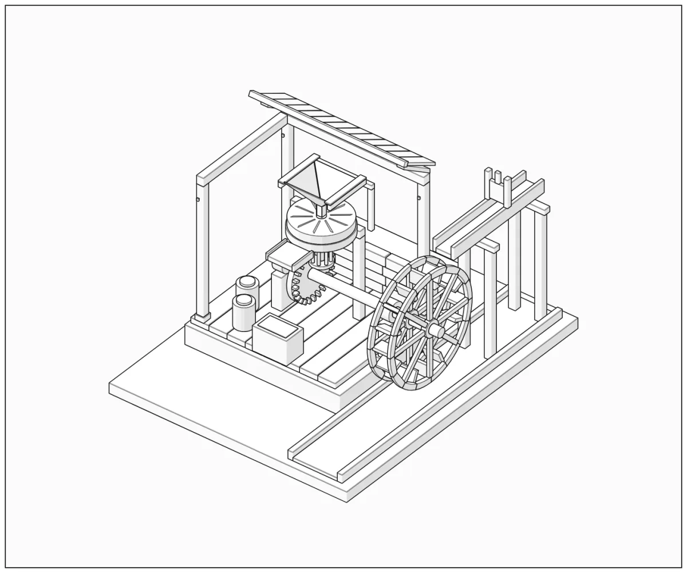

# Figures by @ArtomStatsenko

[Newest](../README.md) · [All figures](../all/1.md) · By kind: [SVG](../by-kind/svg.md) · [SVG + WebGL](../by-kind/webgl.md) · [SVG + 3D](../by-kind/3d.md)

1 figure.

| Preview | Figure |
|---|---|
|  | **Medieval Watermill — Dimensioned Assembly Manual** by [@ArtomStatsenko](../by-author/artomstatsenko.md) SVG · Codex · 2026-10-14 |
