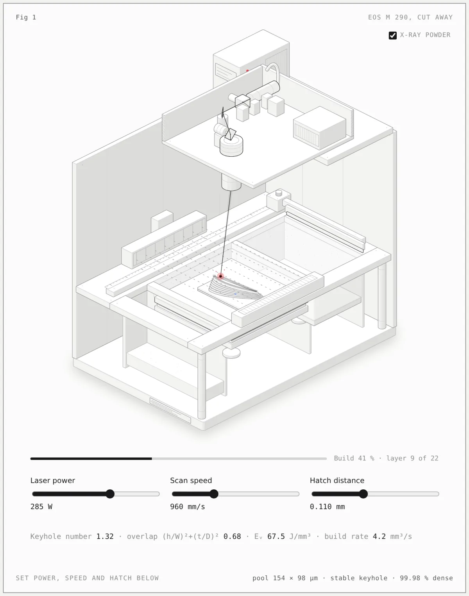

# Figures by @EntangledQuantum

[Newest](../README.md) · [All figures](../all/1.md) · By kind: [SVG](../by-kind/svg.md) · [SVG + WebGL](../by-kind/webgl.md) · [SVG + 3D](../by-kind/3d.md)

1 figure.

| Preview | Figure |
|---|---|
|  | **M 290 Metal 3D Printer, Simulated** by [@EntangledQuantum](../by-author/entangledquantum.md) SVG · Claude Code · 2026-10-13 |
