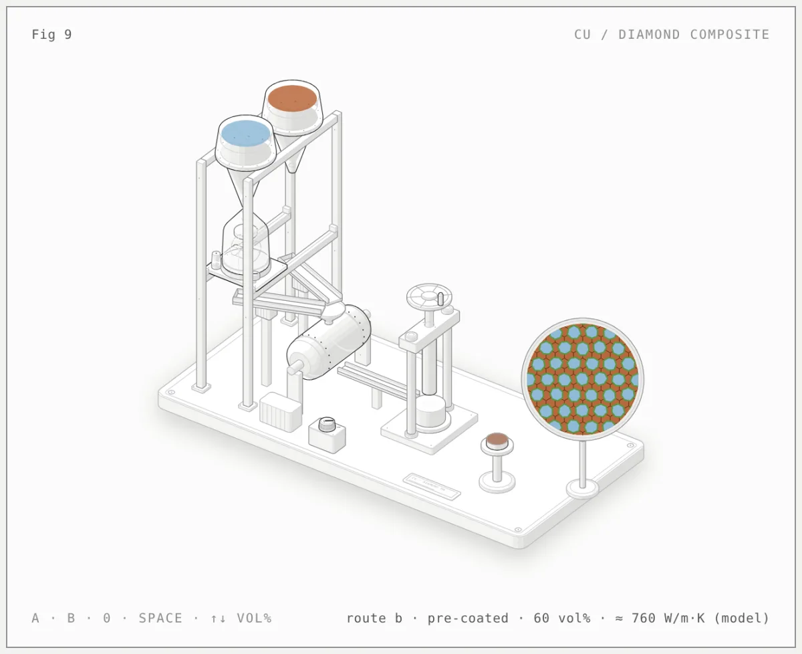
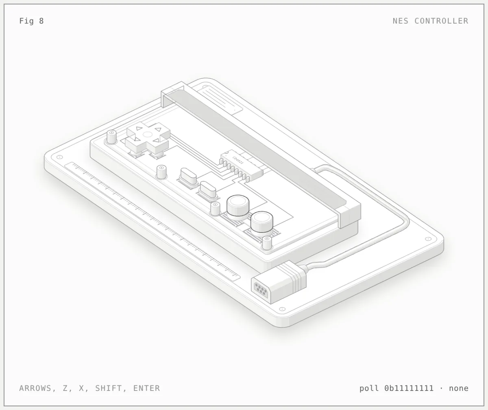
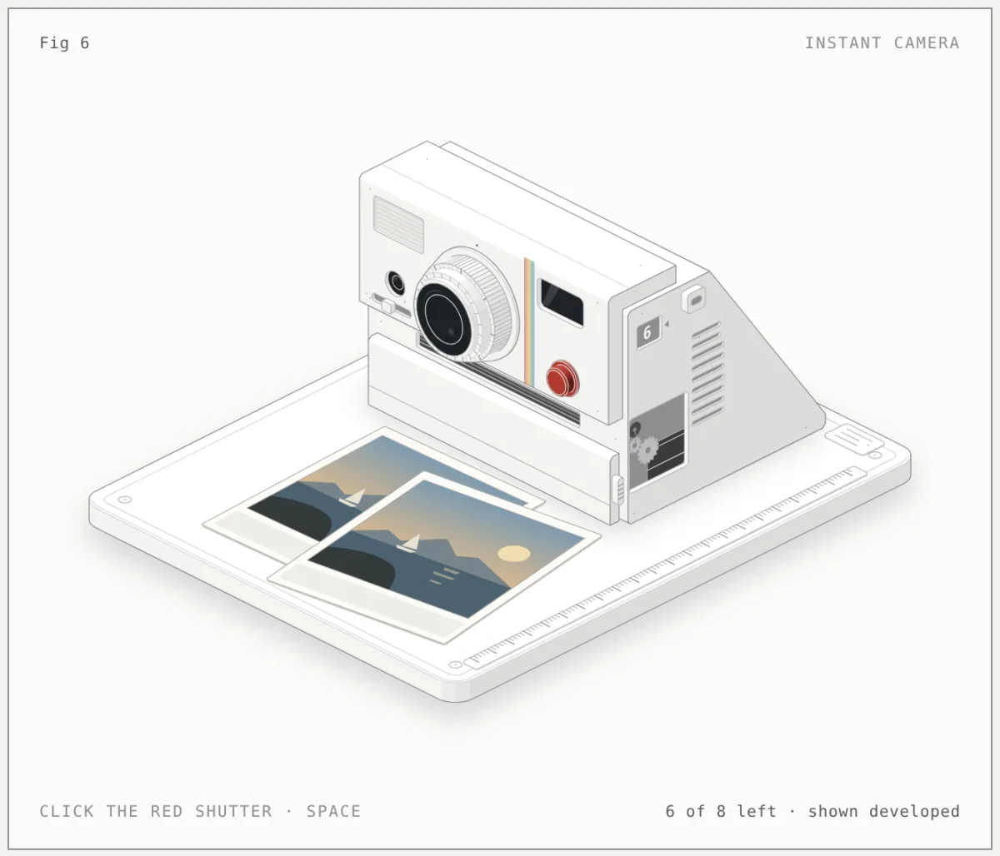
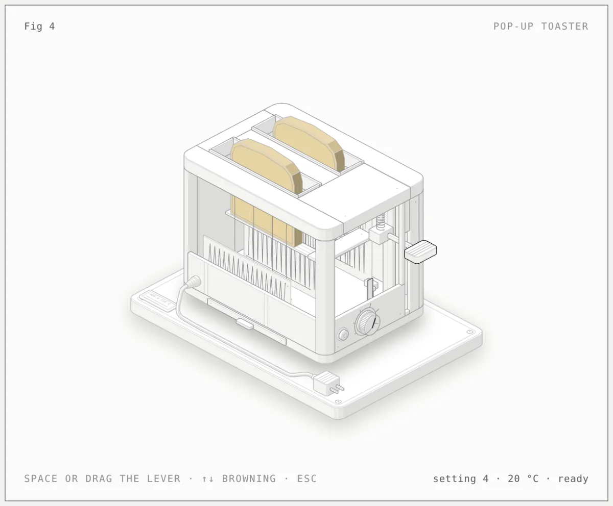

# Figures by @entity

[Newest](../README.md) · [All figures](../all/1.md) · By kind: [SVG](../by-kind/svg.md) · [SVG + WebGL](../by-kind/webgl.md) · [SVG + 3D](../by-kind/3d.md)

10 figures.

| Preview | Figure |
|---|---|
|  | **Cu/diamond composite: post-mixing vs pre-coating** by [@entity](../by-author/entity.md) SVG · Claude Code · 2026-10-12 |
|  | **Film projector** by [@entity](../by-author/entity.md) SVG · Claude Code · 2026-10-12 |
|  | **Game Boy** by [@entity](../by-author/entity.md) SVG · Claude Code · 2026-10-12 |
|  | **Gumball machine** by [@entity](../by-author/entity.md) SVG · Claude Code · 2026-10-12 |
|  | **Jukebox** by [@entity](../by-author/entity.md) SVG · Claude Code · 2026-10-12 |
|  | **Lever espresso machine** by [@entity](../by-author/entity.md) SVG · Claude Code · 2026-10-12 |
|  | **NES controller** by [@entity](../by-author/entity.md) SVG · Claude Code · 2026-10-12 |
|  | **Polaroid camera** by [@entity](../by-author/entity.md) SVG · Claude Code · 2026-10-12 |
|  | **Pop-up toaster** by [@entity](../by-author/entity.md) SVG · Claude Code · 2026-10-12 |
|  | **Walkman cassette player** by [@entity](../by-author/entity.md) SVG · Claude Code · 2026-10-12 |
