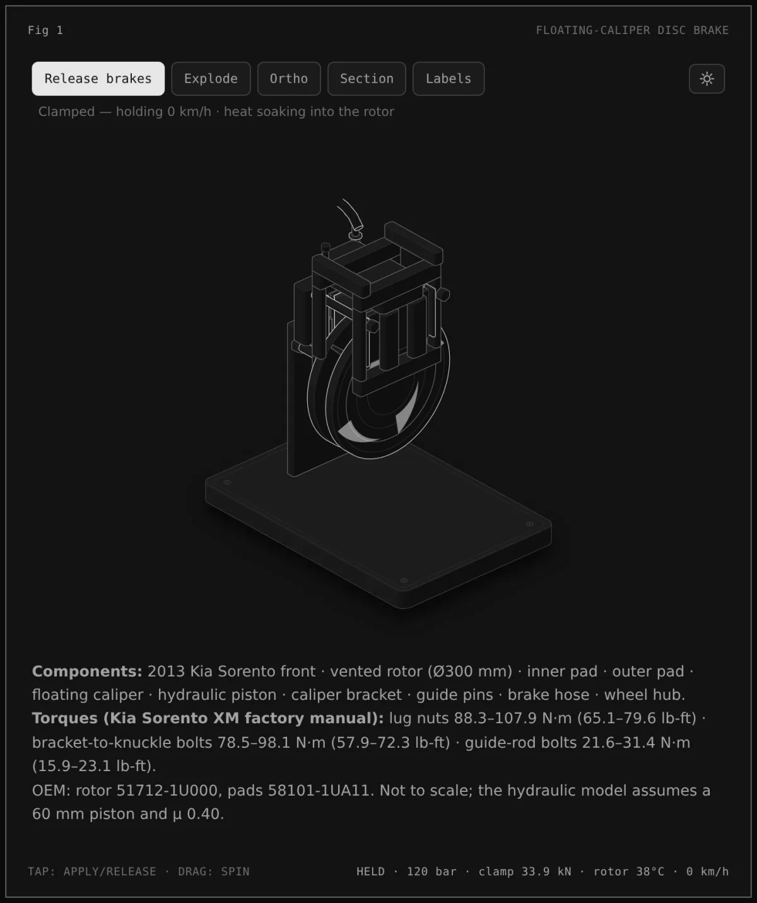

# Figures by @gudguliai

[Newest](../README.md) · [All figures](../all/1.md) · By kind: [SVG](../by-kind/svg.md) · [SVG + WebGL](../by-kind/webgl.md) · [SVG + 3D](../by-kind/3d.md)

1 figure.

| Preview | Figure |
|---|---|
|  | **Floating-caliper disc brake** by [@gudguliai](../by-author/gudguliai.md) SVG &#43; 3D · Other · 2026-10-12 |
