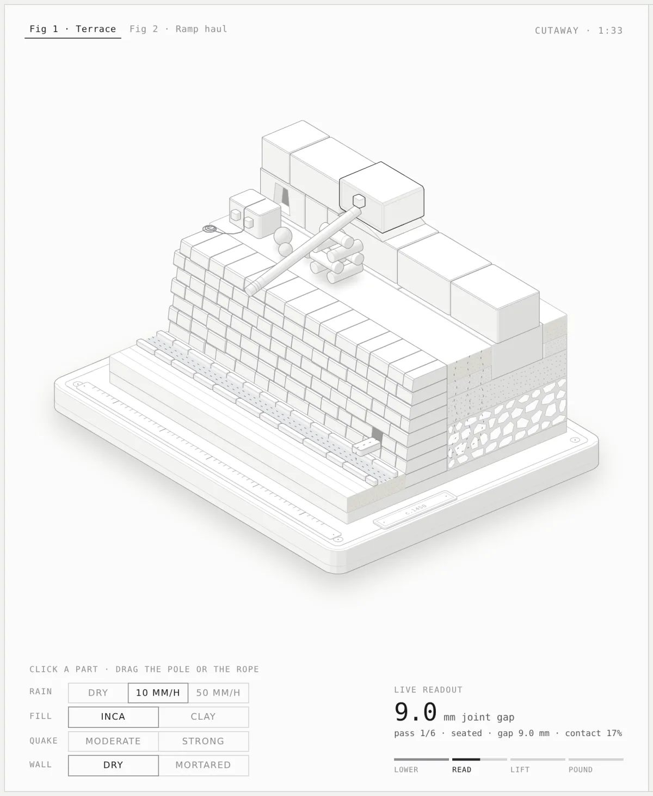

# Figures by @jcroccomendez

[Newest](../README.md) · [All figures](../all/1.md) · By kind: [SVG](../by-kind/svg.md) · [SVG + WebGL](../by-kind/webgl.md) · [SVG + 3D](../by-kind/3d.md)

1 figure.

| Preview | Figure |
|---|---|
|  | **How Machu Picchu was built** by [@jcroccomendez](../by-author/jcroccomendez.md) SVG · Claude Code · 2026-10-12 |
