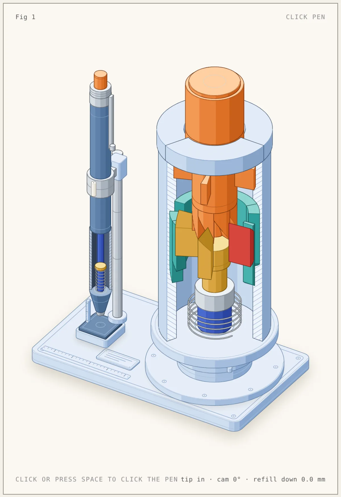
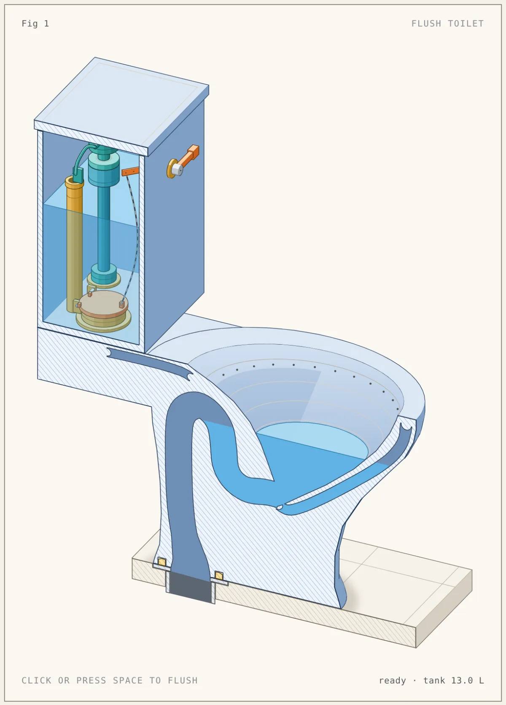
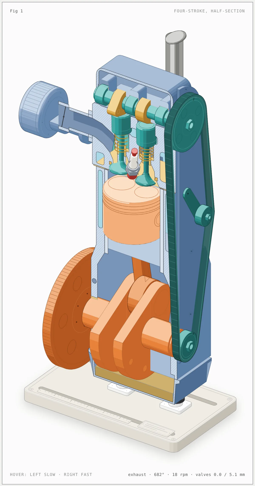
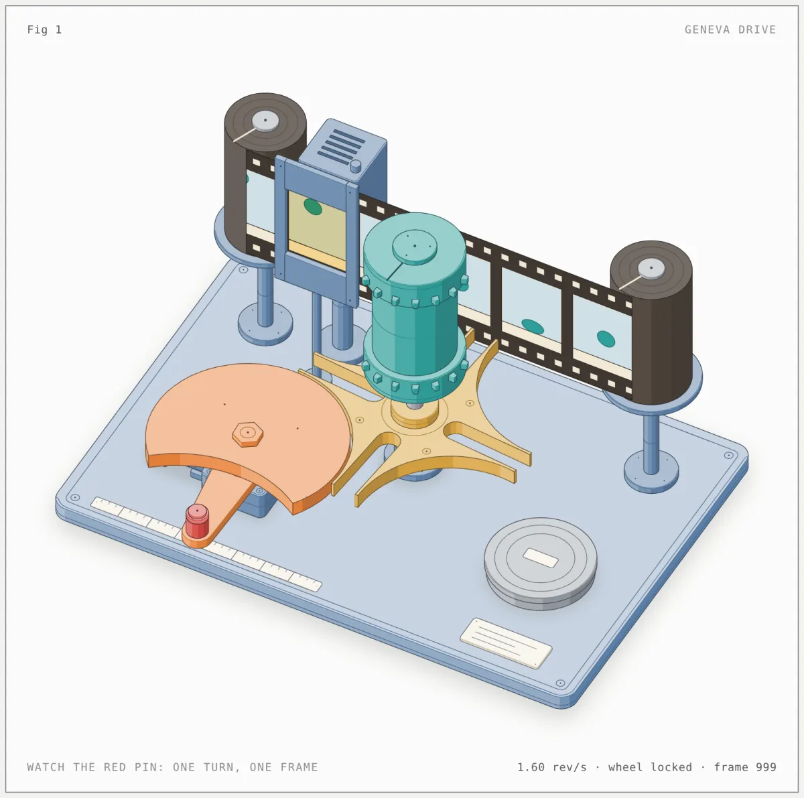
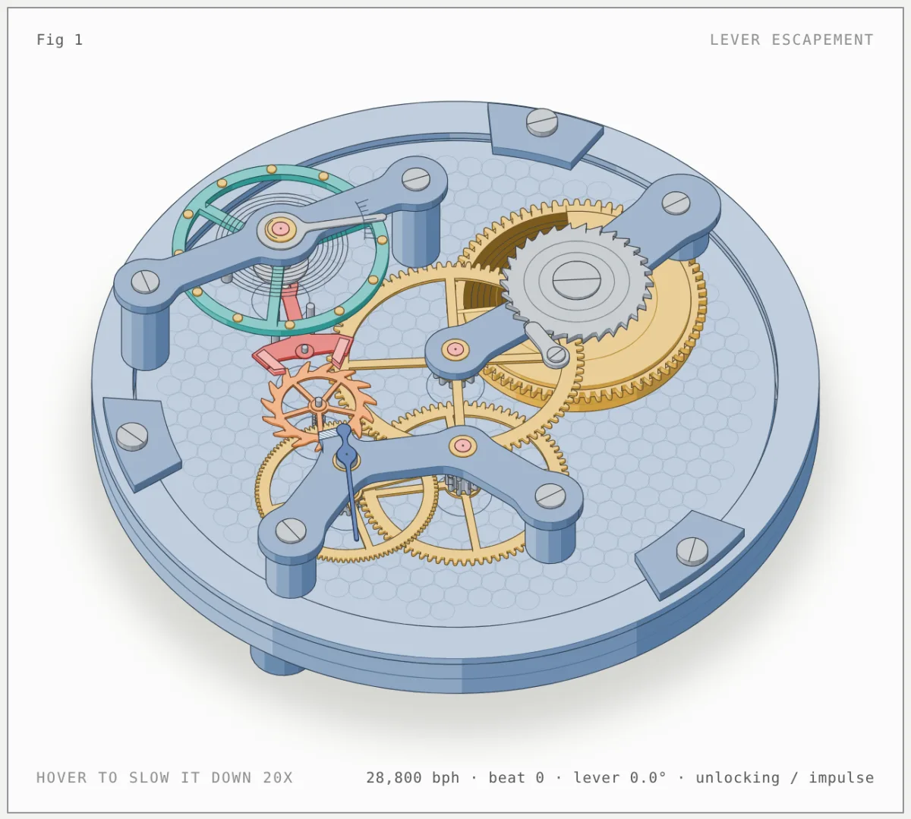
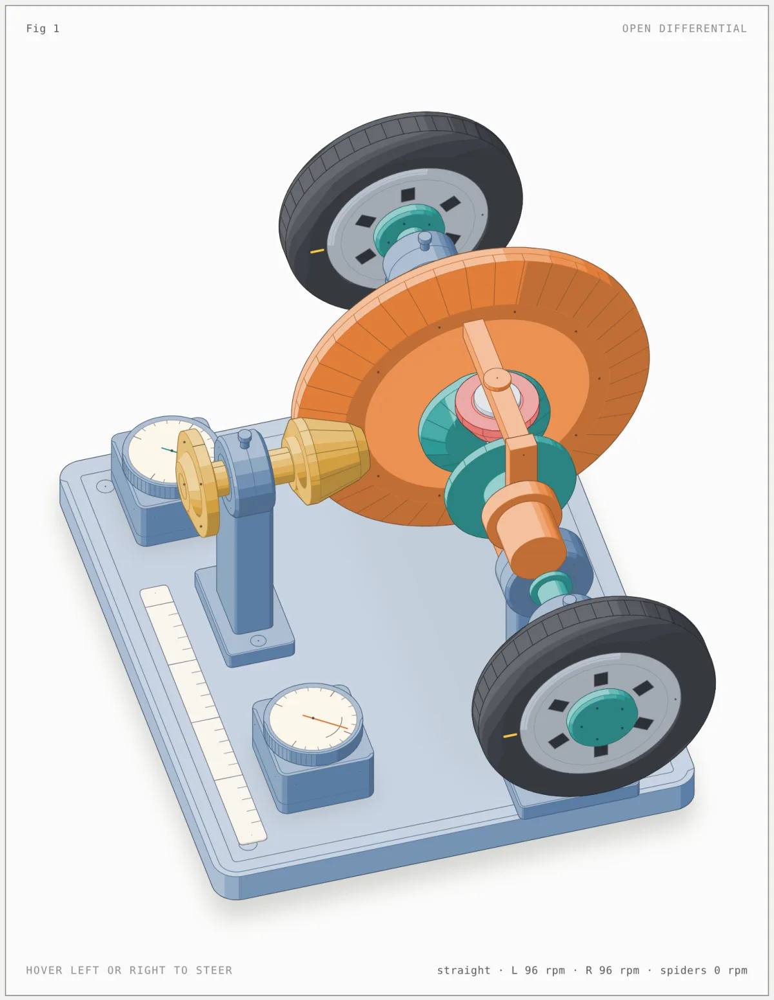
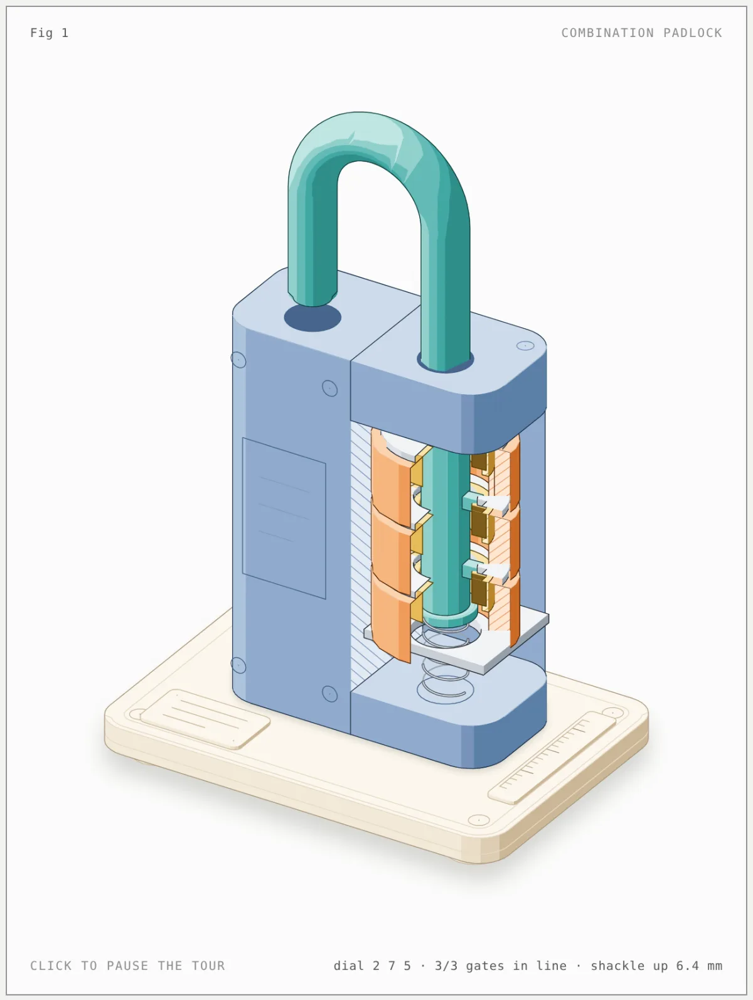
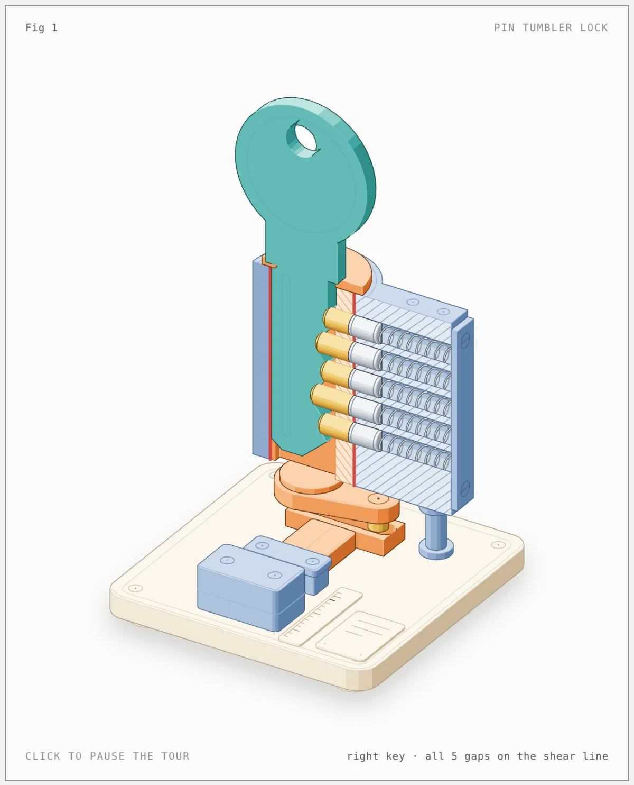
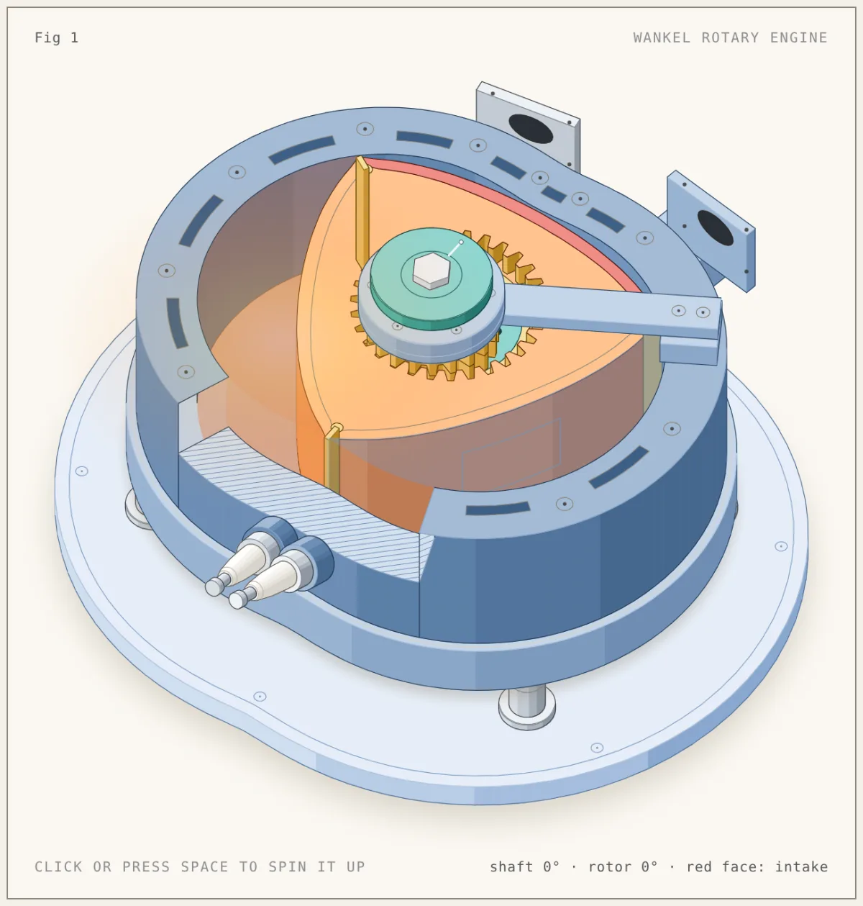
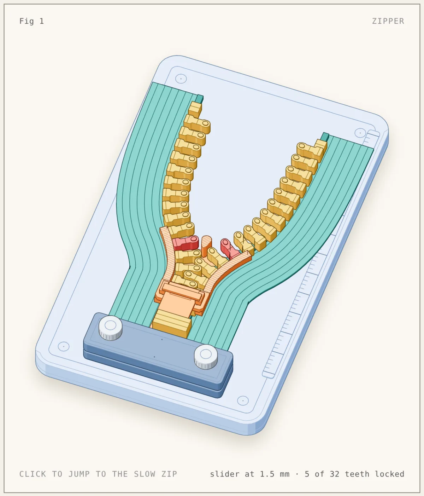

# Figures by @nader0913

[Newest](../README.md) · [All figures](../all/1.md) · By kind: [SVG](../by-kind/svg.md) · [SVG + WebGL](../by-kind/webgl.md) · [SVG + 3D](../by-kind/3d.md)

10 figures.

| Preview | Figure |
|---|---|
|  | **Click pen** by [@nader0913](../by-author/nader0913.md) SVG · Other · 2026-10-12 |
|  | **Flush toilet** by [@nader0913](../by-author/nader0913.md) SVG · Other · 2026-10-12 |
|  | **Four-stroke engine** by [@nader0913](../by-author/nader0913.md) SVG · Other · 2026-10-12 |
|  | **Geneva drive film advance** by [@nader0913](../by-author/nader0913.md) SVG · Other · 2026-10-12 |
|  | **Swiss lever escapement** by [@nader0913](../by-author/nader0913.md) SVG · Other · 2026-10-12 |
|  | **Open differential** by [@nader0913](../by-author/nader0913.md) SVG · Other · 2026-10-12 |
|  | **Combination padlock** by [@nader0913](../by-author/nader0913.md) SVG · Other · 2026-10-12 |
|  | **Pin tumbler lock** by [@nader0913](../by-author/nader0913.md) SVG · Other · 2026-10-12 |
|  | **Wankel rotary engine** by [@nader0913](../by-author/nader0913.md) SVG · Other · 2026-10-12 |
|  | **Zipper** by [@nader0913](../by-author/nader0913.md) SVG · Other · 2026-10-12 |
