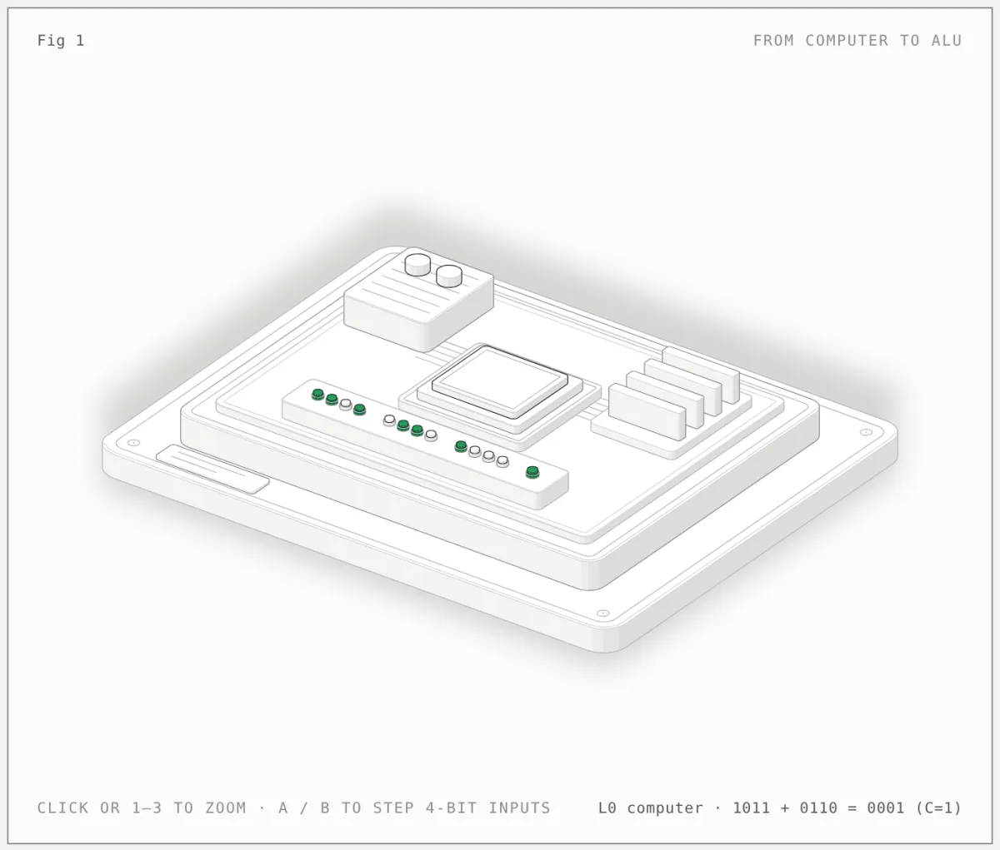
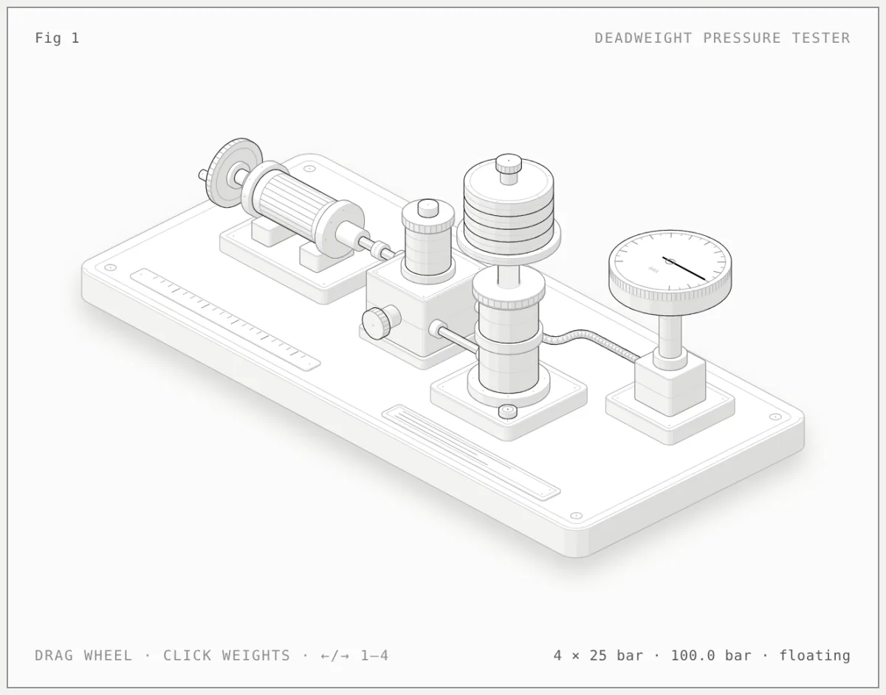
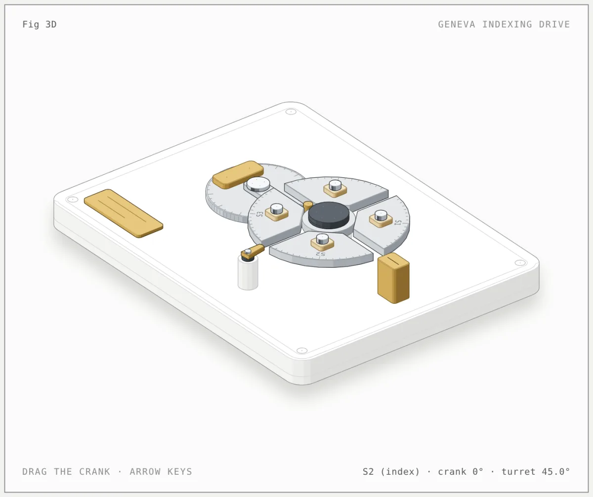

# Figures by @zintaen

[Newest](../README.md) · [All figures](../all/1.md) · By kind: [SVG](../by-kind/svg.md) · [SVG + WebGL](../by-kind/webgl.md) · [SVG + 3D](../by-kind/3d.md)

3 figures.

| Preview | Figure |
|---|---|
|  | **From computer to ALU** by [@zintaen](../by-author/zintaen.md) SVG · Antigravity · 2026-10-16 |
|  | **Deadweight pressure tester** by [@zintaen](../by-author/zintaen.md) SVG · Antigravity · 2026-10-16 |
|  | **Geneva indexing drive** by [@zintaen](../by-author/zintaen.md) SVG &#43; 3D · Antigravity · 2026-10-16 |
